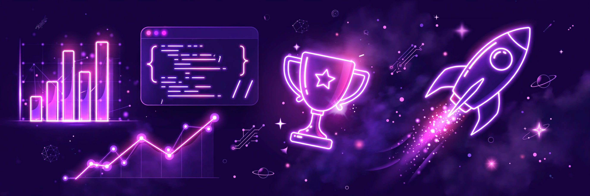

  

<h1 align="center">Hi, I'm Teja Oggu 👋</h1>
<h3 align="center">AI-Augmented Full Stack Developer • Co-founder, Digital Bros Studio • Hyderabad, India</h3>

  <b>I build websites that win clients • AI + Full Stack + Marketing • Premium design, clean code, real results.</b>

  
  
  
  
  

  🏠 <b>Home</b> &nbsp;•&nbsp; 💼 <b>Work</b> &nbsp;•&nbsp; 🛠️ <b>Services</b> &nbsp;•&nbsp; ⚡ <b>Process</b> &nbsp;•&nbsp; 📬 <b>Contact</b>

---

## 👋 About Me

I'm **Teja Oggu** — I turn ideas into premium websites, SaaS products, and AI automations that actually bring in business. No templates, no dead pages — every build is designed to impress visitors and turn them into enquiries.

> “Creation is the highest form of intelligence.”

- 🔭 **Now:** AI web apps, SaaS products, and client websites
- 💼 **Studio:** Digital Bros Studio — web, marketing & automation
- 🎮 **Beyond code:** 6+ years of competitive BGMI esports as **HAC**

### 💻 At a Glance

| | |
|---|---|
| 👨‍💻 **Role** | AI-Augmented Full Stack Developer |
| 🏢 **Studio** | Co-founder @ Digital Bros Studio |
| 📍 **Location** | Hyderabad, India |
| 🎯 **Focus** | Websites that look premium and sell |
| ✅ **Available** | Open for freelance & client work |

**🛠️ Stack:**

  
  
  
  
  
  

---

## 🛠️ Services — What I Can Build For You

<table>
<tr>
<td align="center" width="33%">

### 🌐 Web Development
Business websites, landing pages & portfolios — fast, mobile-first, premium.

</td>
<td align="center" width="33%">

### 🤖 AI Integration
LLM-powered tools, chatbots, content & business automations.

</td>
<td align="center" width="33%">

### 🛒 E-commerce
Online stores & booking flows built to convert visitors into orders.

</td>
</tr>
<tr>
<td align="center" width="33%">

### 🎨 Branding & Design
Clean, modern UI that makes a small business look like a big brand.

</td>
<td align="center" width="33%">

### 📈 Digital Marketing
Meta/Google Ads, social media & Instagram/WhatsApp automation.

</td>
<td align="center" width="33%">

### ⚙️ CRM & SaaS
Custom dashboards, CRM systems & tools that kill repetitive work.

</td>
</tr>
</table>

---

## 💼 Selected Work — Portfolio

<table>
<tr>
<td width="50%">

### 🍽️ Eppie's Restaurant
Restaurant website — menus, vibe & booking flow.
 
`Next.js` `React` `Tailwind`
  
[🔗 Live demo](https://eppies-restaurant-rosy.vercel.app/) • [🌐 More work](https://teja.is-a.dev/#portfolio)

</td>
<td width="50%">

### 🏡 Havener Real Estate
Real estate website — premium listings & enquiries.
 
`Next.js` `React` `Tailwind`
  
[🔗 Live demo](https://havener-real-estate.vercel.app/) • [🌐 More work](https://teja.is-a.dev/#portfolio)

</td>
</tr>
<tr>
<td width="50%">

### 🏨 Silverpoint Estate Hotel
Hotel / resort website — rooms, stays & experience.
 
`Next.js` `React` `Tailwind`
  
[🔗 Live demo](https://silverpoint-estate-hotel.vercel.app/) • [🌐 More work](https://teja.is-a.dev/#portfolio)

</td>
<td width="50%">

### ✈️ Alkanz Tours
Travel website — tours, destinations & enquiries.
 
`Next.js` `React` `Tailwind`
  
[🔗 Live demo](https://alkanztourscom.vercel.app/) • [🌐 More work](https://teja.is-a.dev/#portfolio)

</td>
</tr>
<tr>
<td width="50%">

### 🔧 Rise Up Plumbing
Home services website — trust, services & calls to action.
 
`Next.js` `React` `Tailwind`
  
[🔗 Live demo](https://riseup-plumbing.vercel.app/) • [🌐 More work](https://teja.is-a.dev/#portfolio)

</td>
<td width="50%">

### 🎨 Yash Soni — 3D Portfolio
Premium interactive 3D portfolio build.
 
`Three.js` `Next.js` `GSAP`
  
[🔗 yashsoni.is-a.dev](https://yashsoni.is-a.dev) • [🌐 More work](https://teja.is-a.dev/#portfolio)

</td>
</tr>
<tr>
<td width="50%">

### 🌐 Teja Oggu Portfolio
My main portfolio — AI full-stack, SaaS & client work.
 
`Next.js` `React` `TypeScript`
  
[🔗 teja.is-a.dev](https://teja.is-a.dev)

</td>
<td width="50%">

### 🏢 Digital Bros Studio
My agency site — web, marketing & automation services.
 
`Next.js` `React` `Tailwind`
  
[🔗 digitalbrosstudio.tech](https://digitalbrosstudio.tech)

</td>
</tr>
</table>

---

## ✨ Design Style

  ⚡ <b>Fast</b> &nbsp;•&nbsp; 📱 <b>Mobile-first</b> &nbsp;•&nbsp; 🎨 <b>Premium look</b> &nbsp;•&nbsp; 🎯 <b>Built to convert</b> &nbsp;•&nbsp; 🧩 <b>Easy to update</b>

## ⚡ My Process

  <b>1. Discover</b> → <b>2. Design</b> → <b>3. Build</b> → <b>4. Launch & Grow</b>

---

## 🧰 Tools & Tech Icons

  
  
  
  
  
  
  

---

## 🧪 Currently Brewing

| Project | Status |
|---|---|
| **LUCY AI** | Coming soon — posters, flyers, ad creatives & 4K images from prompts |
| **Jarvis** | In progress — personal voice-controlled AI assistant |
| **Melody** | In progress — Spotify-style music player project |

*Honestly marked as in-progress / coming soon — not launched yet.*

---

## 📊 GitHub Stats

  

  

| 🔥 At a glance | 📈 Number |
|---|---|
| Total contributions | **325** |
| Current streak | **2 days** (Nov 3 – Nov 4) |
| Longest streak | **8 days** (Sep 6 – Sep 13) |

*Numbers above are from the streak card shown on Nov 4 — the live streak card above stays current, and GitHub's own contribution graph below the README always shows the full activity.*

> Note: the old stats, top-languages, activity-graph and trophy widgets were removed on purpose — those third-party services are currently returning errors (503 / 402), which is why they showed as broken images. Everything left in this section is either hosted in this repo or the one streak service that is actually working.

---

## 🐍 Contribution Snake

  

---

## 🌍 Beyond Code

<table>
<tr>
<td align="center" width="33%">

### 🎮 BGMI Esports
**HAC** — 6+ years competitive, regional finals experience

</td>
<td align="center" width="33%">

### 📈 Trading
Intraday & forex focus — price action, risk & discipline

</td>
<td align="center" width="33%">

### 🎵 Music & Products
Building Melody, plus creative & agency work

</td>
</tr>
</table>

---

## 📬 Let's Work Together

Got a website, store, SaaS idea, or AI automation in mind? Let's build it properly.

- 🌐 Full portfolio: [teja.is-a.dev/#portfolio](https://teja.is-a.dev/#portfolio)
- 🏢 Agency: [digitalbrosstudio.tech](https://digitalbrosstudio.tech)
- 💼 LinkedIn: [Raviteja Oggu](https://www.linkedin.com/in/raviteja-oggu-56916843a/)
- 📧 Email: sonylucky46hac@gmail.com

  ⭐ If you like a project, star it — it genuinely helps.

  <b>Thanks for visiting — let's build something great. 🚀</b>

